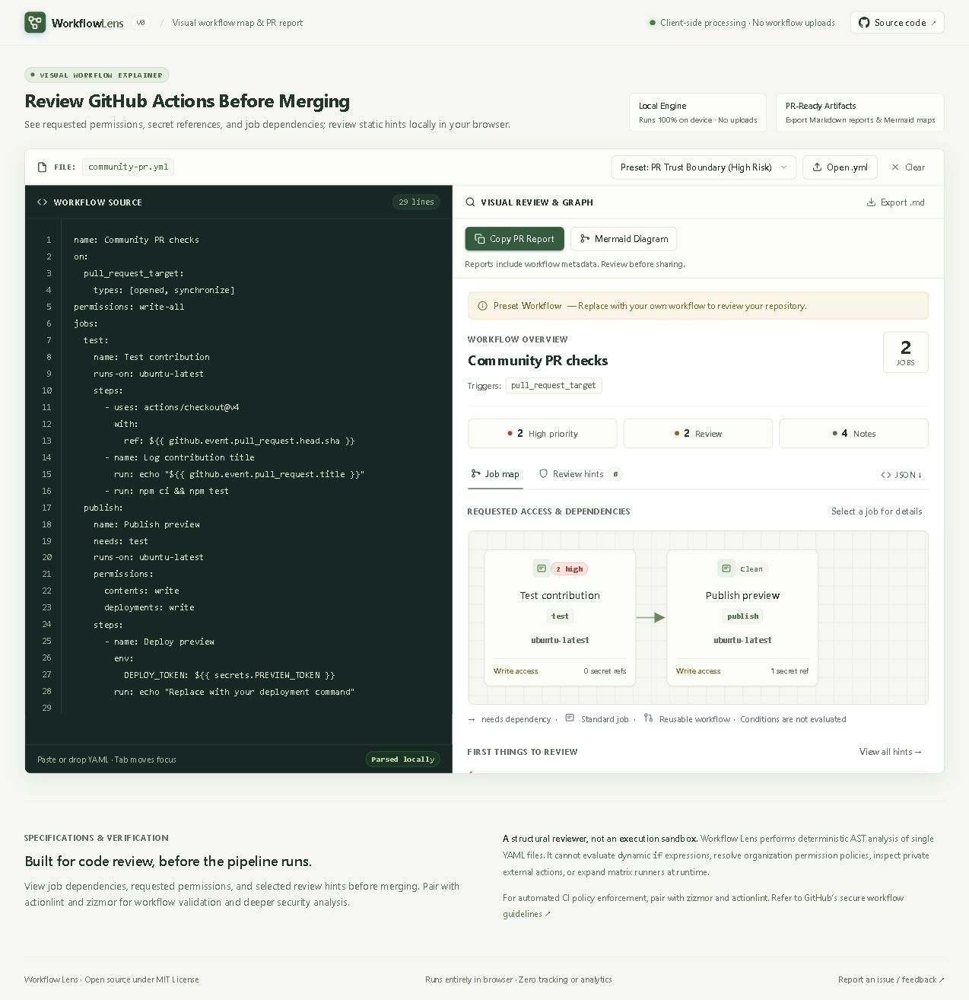

# Workflow Lens

[](https://github.com/sreyasts/workflow-lens/actions/workflows/ci.yml)
[](https://sreyasts.github.io/workflow-lens/)
[](action.yml)
[](LICENSE)

**Turn GitHub Actions YAML into a dependency map and a PR review report.**

[Open the app](https://sreyasts.github.io/workflow-lens/) · [Report a problem](https://github.com/sreyasts/workflow-lens/issues/new?template=feedback.md) · [Contribute](CONTRIBUTING.md)

Paste or open a workflow to see its job dependencies, requested token permissions, secret references, and review hints. Processing happens on your device. No sign-in, uploads, external fonts, analytics, or AI API calls.



## What it does

- Draws the dependency map for a single YAML workflow; select a job for access details.
- Shows job permission overrides, unknown repository defaults, and named secret references.
- Flags review patterns including privileged PR checkout, direct untrusted script interpolation, broad permissions, mutable action references, and inherited secrets.
- Links findings back to source lines and GitHub's guidance.
- Copies a PR-ready Markdown report with a Mermaid dependency diagram; exports Markdown, JSON, and standalone Mermaid. The CLI uses the same analyzer as the app.

## Try a review in one minute

1. [Open the app](https://sreyasts.github.io/workflow-lens/) and explore the bundled PR trust-boundary example. No installation required.
2. Select a job to inspect requested permissions and secret references. Follow a hint's line link back to the YAML.
3. Open your own `.yml` file, then choose **Copy PR report**. Review the metadata before pasting into a GitHub PR or issue; GitHub renders the embedded Mermaid diagram.

Use **Mermaid diagram** for a standalone map, or **Export report** if clipboard access is unavailable. Exports always include the whole workflow, regardless of view filters.

## Choose the right tool

| Need | Tool |
| --- | --- |
| Explain job dependencies and requested access visually; share a review artifact | Workflow Lens |
| Validate workflow syntax, expressions, and more | [actionlint](https://github.com/rhysd/actionlint) |
| Run deeper GitHub Actions security analysis | [zizmor](https://docs.zizmor.sh/) |

Workflow Lens complements those tools. It does not establish whether a workflow is safe or valid.

The bundled workflows are illustrative examples, not real vulnerability reports. Input is held in memory and is cleared on refresh. Exported reports can contain job names, action references, and secret **names** from your input; review a report before sharing it. Hosting providers still receive ordinary page requests. Opening documentation or repository links leaves the app.

## Run locally

Requires Node.js 24+ and npm.

```sh
git clone https://github.com/sreyasts/workflow-lens.git
cd workflow-lens
npm ci
npm run dev
```

```sh
npm test
npm run build
npm run preview
```

The app is static and can be served from any static host. The included Pages workflow deploys the default branch when GitHub Pages uses GitHub Actions as its source.

## CLI

Build and run the CLI from this checkout:

```sh
npm ci
npm run build
npm run inspect -- .github/workflows/ci.yml
npm run inspect -- .github/workflows/ci.yml --json
npm run inspect -- .github/workflows/ci.yml --fail-on-high
npm run inspect -- .github/workflows/ci.yml --mermaid > workflow.mmd
npm run inspect -- .github/workflows/ci.yml > review.md
```

The npm package has not been published, so `npx` and global-install commands are not available yet. Use `-` instead of a filename to read stdin. `--json` and `--mermaid` are mutually exclusive. Exit status is 2 for input or parsing errors, 1 for high-priority hints when `--fail-on-high` is set, and 0 otherwise.

## GitHub Action

The composite action is not released under a stable reference yet. Do not use `@main` in production workflows; pin a full commit SHA once the action is available from the public repository.

## Scope and limits

Workflow Lens is an early static explanation tool, **not a full workflow validator or security audit**. A zero-hint report does not establish safety. Findings are review heuristics and may be intentional or incomplete.

It does not evaluate `if` conditions, expand matrices or reusable workflows, fetch external actions, inspect remote scripts, resolve organization policies, identify real secret values, verify action commit provenance, or model runtime exploitation. Permissions shown are **requested**, not guaranteed effective permissions. OIDC `id-token` permissions are displayed alongside other requested scopes; they are distinct from repository token write access. Secret references do not prove which credentials are available at runtime. Dynamic expressions can remain unresolved.

Single-document YAML 1.2 only. Aliases and custom tags are rejected. Limits: 256 KB, 100 jobs, 1,000 steps, and 40 nested levels. Syntax errors, missing job dependencies, and cycles are surfaced before displaying a map. This is not complete GitHub Actions schema validation.

Pair with [zizmor](https://docs.zizmor.sh/) for deeper workflow security analysis and [actionlint](https://github.com/rhysd/actionlint) for workflow validation. Rule rationale follows [GitHub's secure-use reference](https://docs.github.com/en/actions/reference/security/secure-use).

## Contributing

Useful first contributions: sanitized workflows that the tool explains incorrectly, precise false-positive reports, keyboard accessibility improvements, and fixtures for documented rules. See [CONTRIBUTING.md](CONTRIBUTING.md) and [SECURITY.md](SECURITY.md).

MIT licensed. No adoption or star-count claims are made. This project is independently maintained and is not affiliated with GitHub or OpenAI.
