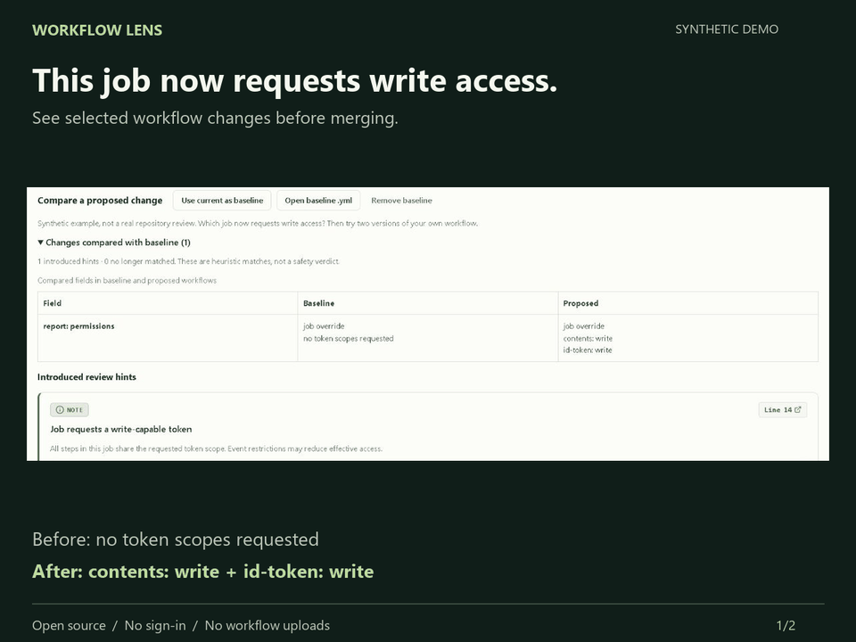

# Workflow Lens

[](https://github.com/sreyasts/workflow-lens/actions/workflows/ci.yml)
[](https://www.npmjs.com/package/@sreyasts/workflow-lens)
[](https://sreyasts.github.io/workflow-lens/)
[](https://github.com/sreyasts/workflow-lens/blob/main/action.yml)
[](LICENSE)

**Review which GitHub Actions job gained requested permissions, what it depends on, and what to inspect next.**

[Try a before/after review](https://sreyasts.github.io/workflow-lens/?example=compare) · [Read real permission changes](docs/PERMISSION-CHANGE-EVALUATION.md) · [Report a problem](https://github.com/sreyasts/workflow-lens/issues/new?template=feedback.md)

Paste or open a workflow to see its job dependencies, requested token permissions, secret references, and review hints. Processing happens on your device. No sign-in, uploads, external fonts, analytics, or AI API calls.

## See the result before installing

You are reviewing a workflow change. The `report` job used to request no token scopes; the proposed version requests write scopes. Workflow Lens connects that change to the job and its dependencies:

| Review question | What this example shows |
| --- | --- |
| Which job changed? | `report`, with an explicit job permission override |
| What access does it request now? | `contents: write` and `id-token: write` (OIDC) |
| What must run first? | `test`, through `needs: test` |
| What should I check next? | Whether every step in `report` needs these scopes, and whether event restrictions and repository policy allow them |



**Synthetic example, not an independent review.** Inspect the [before YAML](docs/examples/permission-change/before.yml), [proposed YAML](docs/examples/permission-change/after.yml), and [actual generated Markdown report](docs/examples/permission-change/report.md) entirely on GitHub. The [walkthrough](docs/REVIEW-WALKTHROUGH.md) explains how to reproduce it and what it misses.

For a real repository input, inspect [this project's own CI report](docs/examples/self-review/report.md) alongside its [pinned workflow source](https://github.com/sreyasts/workflow-lens/blob/06527a022baa6684ef868dc32883b1cd7250b09b/.github/workflows/ci.yml). This is maintainer self-use, not independent adoption.

Use this when a visual access/dependency overview or a shareable report helps your review. For a small change, your normal diff may already be clearer. This compares selected fields, not full workflow behavior; keep reviewing scripts and the ordinary diff.

**Checked against real changes:** [six public workflow pairs from four PRs](docs/PERMISSION-CHANGE-EVALUATION.md), with pinned inputs, generated reports and an offline evaluator. The permission rows match the maintainer's labels in all six; two real scope gains produce zero new hints. The write-up includes inference mistakes, unknown defaults and coverage limits. This is a curated evaluation, not independent usage or general accuracy evidence.

## What it does

- Draws the dependency map for a single YAML workflow; select a job for access details.
- Compares a baseline and proposed workflow in the browser, highlighting selected field changes and newly matching review hints.
- Shows job permission overrides, unknown repository defaults, and secret references inside expressions. Literal text is excluded; named secrets follow GitHub's [case-insensitive naming rules](https://docs.github.com/en/actions/reference/security/secrets). Dynamic references stay unresolved.
- Flags review patterns including privileged PR checkout, direct untrusted script interpolation, broad permissions, mutable action references, and inherited secrets.
- Links findings back to source lines and GitHub's guidance.
- Copies a PR-ready Markdown report with a Mermaid dependency diagram; exports Markdown, JSON, and standalone Mermaid. The CLI uses the same analyzer as the app.

## Try a review in one minute

New here? [Open the before/after example](https://sreyasts.github.io/workflow-lens/?example=compare), find the changed permission row, then select `report` in the job map. No installation required.

1. Open the **old version of your workflow** and choose **Use current as baseline**.
2. Open the **proposed version** with **Open .yml**. Inspect the comparison, select a job, and follow a hint's line link to the YAML.
3. Choose **Copy PR Report** or **Export .md**. Review the metadata before sharing; GitHub renders the report's Mermaid diagram.

Alternatively, use **Open baseline .yml** to select the old version directly. Opening your own proposed file clears the synthetic example baseline; a baseline you explicitly choose is retained. Use **Mermaid Diagram** for a standalone proposed-workflow map. Exports include the whole analysis, regardless of view filters.

**Help test this on real reviews:** we are seeking five maintainers who review GitHub Actions changes. [Join the pilot](https://github.com/sreyasts/workflow-lens/discussions/5), or [share a completed review experience](https://github.com/sreyasts/workflow-lens/issues/new?template=review-experience.md). Tell us what helped or confused you; no star or endorsement is requested.

## Which version should I use?

| Entry point | Available now |
| --- | --- |
| [Browser app](https://sreyasts.github.io/workflow-lens/?example=compare) | Before/after comparison, visual map, review hints and exports; no installation |
| Published npm `0.1.0` | Single-workflow inspection; **no `--compare`** |
| GitHub Action `v0` / `v0.1.0` | Released single-workflow action; **no new job-summary option** |
| Current source (`0.1.1` candidate) | CLI comparison and job summaries; build from source as shown below; unreleased |

## Choose the right tool

| Need | Tool |
| --- | --- |
| Explain job dependencies and requested access visually; share a PR report | Workflow Lens |
| Validate workflow syntax and expressions | [actionlint](https://github.com/rhysd/actionlint) |
| Run deeper GitHub Actions security analysis | [zizmor](https://docs.zizmor.sh/) |

Workflow Lens complements these tools. No matching hints does not establish safety.

## Quick CLI Inspection (npx)

Requires Node.js 22.18.0 or later. `npx` downloads and runs the published package without a project installation:

```sh
npx @sreyasts/workflow-lens .github/workflows/ci.yml
npx @sreyasts/workflow-lens .github/workflows/ci.yml --json
npx @sreyasts/workflow-lens .github/workflows/ci.yml --fail-on-high
npx @sreyasts/workflow-lens .github/workflows/ci.yml --mermaid > workflow.mmd
```

Or install globally:

```sh
npm install -g @sreyasts/workflow-lens
workflow-lens .github/workflows/ci.yml
```

Use `-` instead of a filename to read from stdin (e.g., `cat workflow.yml | npx @sreyasts/workflow-lens -`). `--json` and `--mermaid` are mutually exclusive. Exit status is 2 for input or parsing errors, 1 for high-priority hints when `--fail-on-high` is set, and 0 otherwise.

## Review a proposed workflow change

The browser app supports an optional baseline: choose **Use current as baseline**, then edit or open the proposed workflow. Alternatively, **Open baseline .yml** loads the previous version. The comparison shows changes to requested permissions, secret references, events, jobs, dependencies, action references, reusable-workflow targets, runners and conditions, plus newly matching and no-longer-matching hints. Markdown and JSON exports include both versions; Mermaid exports the proposed map. Neither file is uploaded or saved across reloads.

The **unreleased 0.1.1 source candidate** also supports CLI comparison; the published npm **0.1.0 does not**. From a source checkout:

```sh
npm ci
npm run build
node bin/workflow-lens.js proposed.yml --compare baseline.yml
node bin/workflow-lens.js proposed.yml --compare baseline.yml --json
```

The proposed input may be `-` for stdin; the baseline must be a regular file. Comparison cannot be combined with `--mermaid`. Invalid input on either side exits 2 without classifying differences. `--fail-on-high` checks **all** high hints in the proposed workflow, including preexisting ones.

This compares selected fields, not complete YAML behavior. Scripts, action inputs, trigger filters, matrices, environments, containers and other changes may be omitted. Conditions are compared as text; unknown permissions remain unknown. A disappearing hint does not prove a vulnerability was fixed, and no listed differences does not establish equivalence or safety. Continue reviewing the ordinary diff and running actionlint/zizmor.

## GitHub Action

Run Workflow Lens directly in your GitHub Actions workflows:

```yaml
- name: Review Workflow with Workflow Lens
  uses: sreyasts/workflow-lens@v0
  with:
    workflow: '.github/workflows/ci.yml'
    format: 'markdown'
    fail-on-high: 'true'
```

The `v0` tag follows the latest stable action release and can move. For production workflows, pin the action to a verified full commit SHA.

The **unreleased 0.1.1 candidate** also appends a Markdown review to the GitHub job summary by default, using the same analysis as the step log. The `format` input still controls log output. High-hint and parse-error reports remain visible before exit codes 1 and 2; a summary write failure only warns. Set `summary: 'false'` to keep workflow metadata out of the summary; log output remains available. **The current `v0`/`v0.1.0` release does not include this option**; use a verified source commit containing the change until a new release is published.

## Supported versions

Only the latest stable versioned release is supported. The npm CLI package requires Node.js 22.18.0 or later; CI currently checks Node.js 22.18.0 and 24. Older releases receive no maintenance guarantee. See the [release policy](https://github.com/sreyasts/workflow-lens/blob/main/docs/RELEASE.md).

## Scope and limits

Workflow Lens is an early static explanation tool, **not a full workflow validator or security audit**. A zero-hint report does not establish safety. Findings are review heuristics and may be intentional or incomplete.

It does not evaluate `if` conditions, expand matrices or reusable workflows, fetch external actions, inspect remote scripts, resolve organization policies, identify real secret values, verify action commit provenance, or model runtime exploitation. Permissions shown are **requested**, not guaranteed effective permissions. OIDC `id-token` permissions are displayed alongside other requested scopes; they are distinct from repository token write access. Secret references do not prove which credentials are available at runtime. Dynamic expressions can remain unresolved.

Single-document YAML 1.2 only. Aliases and custom tags are rejected. Limits: 256 KB, 100 jobs, 1,000 steps, and 40 nested levels. Syntax errors, missing job dependencies, and cycles are surfaced before displaying a map. This is not complete GitHub Actions schema validation.

Pair with [zizmor](https://docs.zizmor.sh/) for deeper workflow security analysis and [actionlint](https://github.com/rhysd/actionlint) for workflow validation. Rule rationale follows [GitHub's secure-use reference](https://docs.github.com/en/actions/reference/security/secure-use).

Expression inspection is lexical: it separates expression bodies and quoted values, including literal bracket property names, but does not evaluate conditions, function results or dynamic property keys. A card labeled **No high hints** means no matching high-priority rule, and **OIDC requested** describes `id-token: write`, not repository-token write access.

## Contributing

The [privileged-checkout evaluation](docs/EVALUATION.md) records 20 synthetic positive/negative cases, a reproducible before/after comparison and its limits. Run `npm run evaluate` from a source checkout; this is a rule regression evaluation, not an independent security benchmark.

Useful first contributions: sanitized workflows that the tool explains incorrectly, precise false-positive reports, keyboard accessibility improvements, and fixtures for documented rules. See [CONTRIBUTING.md](CONTRIBUTING.md) and [SECURITY.md](SECURITY.md).

MIT licensed. No adoption or star-count claims are made. This project is independently maintained and is not affiliated with GitHub or OpenAI.
