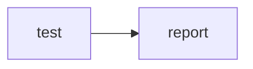

# Workflow Lens change review

Selected static differences, not a complete YAML diff or security certification. Neither workflow was executed.

## Selected field changes

| Scope | Field | Before | After |
| --- | --- | --- | --- |
| Job: report | permissions | job override; no token scopes requested | job override; contents: write; id-token: write |

## Newly matching review hints

- INFO: Job requests a write-capable token — write-token; job report; after line 14
  All steps in this job share the requested token scope. Event restrictions may reduce effective access.
  Review: Keep write access isolated to the job that needs it; review each action in that job.

## No longer matching review hints

None.

## Limits

- Only the listed analyzer fields are compared. Scripts, action inputs, trigger filters, matrices, environments, containers, and other YAML changes may be omitted; no listed differences does not mean equivalent behavior or safety.
- Permissions are requested scopes, not effective runtime access. Repository defaults, event restrictions, organization policies, and external actions are not resolved.
- Job IDs identify jobs; renaming an ID appears as a removed and added job. Conditions are compared as text, not evaluated. Action references retain their order and duplicates; action behavior is not inspected.
- Hint differences match rule, severity, job, detail, and advice as a multiset, ignoring line and step positions. Identical hints in different steps cannot be distinguished; a disappearing hint does not prove a security issue was fixed.
- Requested permissions are shown. Event restrictions, organization policies, environments, and external action behavior are not resolved.

Generated locally with [Workflow Lens](https://sreyasts.github.io/workflow-lens/).

# Workflow Lens: Minimal CI

Static review hints, not a security certification. No workflow was executed.

Triggers: push, pull&#95;request | Jobs: 2

## Job dependencies

Arrows show needs dependencies. Conditions are not evaluated.

## Job: test
Runner: ubuntu-latest
Needs: none
Requested permissions: {&#34;contents&#34;:&#34;read&#34;}
Secret references: none detected

## Job: report
Runner: ubuntu-latest
Needs: test
Requested permissions: {&#34;contents&#34;:&#34;write&#34;,&#34;id-token&#34;:&#34;write&#34;}
Secret references: none detected

## INFO: Job requests a write-capable token
Rule: write-token | Line: 14 | Job: report
All steps in this job share the requested token scope. Event restrictions may reduce effective access.
Review: Keep write access isolated to the job that needs it; review each action in that job.
Reference: https://docs.github.com/en/actions/reference/security/secure-use

## Limits
Requested permissions are shown. Event restrictions, organization policies, environments, and external action behavior are not resolved.

Generated locally with [Workflow Lens](https://sreyasts.github.io/workflow-lens/).

