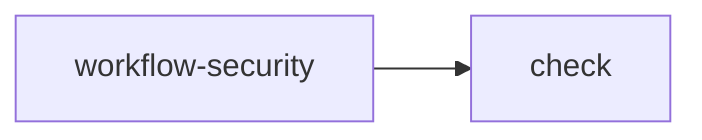

# Workflow Lens: Checks

Static review hints, not a security certification. No workflow was executed.

Triggers: push, pull&#95;request | Jobs: 2

## Job dependencies

Arrows show needs dependencies. Conditions are not evaluated.

## Job: workflow-security
Runner: ubuntu-latest
Needs: none
Requested permissions: {&#34;contents&#34;:&#34;read&#34;}
Secret references: none detected

## Job: check
Runner: ubuntu-latest
Needs: workflow-security
Requested permissions: {&#34;contents&#34;:&#34;read&#34;}
Secret references: none detected

## Limits
Requested permissions are shown. Event restrictions, organization policies, environments, and external action behavior are not resolved.

Generated locally with [Workflow Lens](https://sreyasts.github.io/workflow-lens/).

